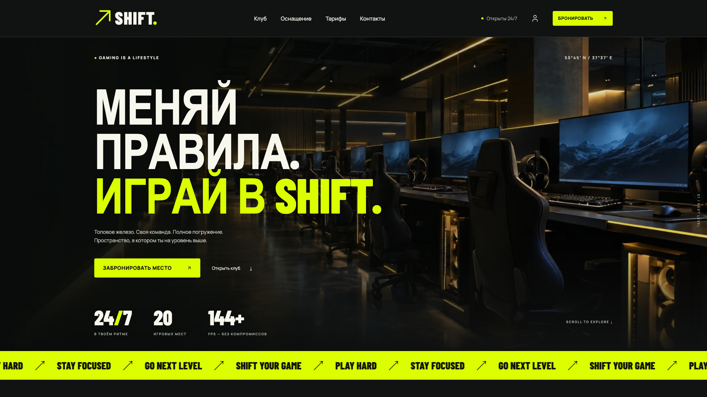
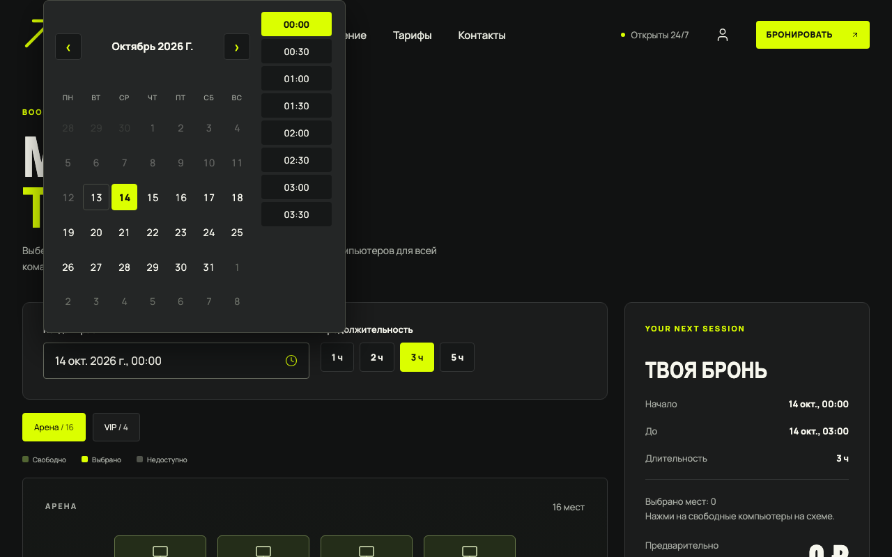
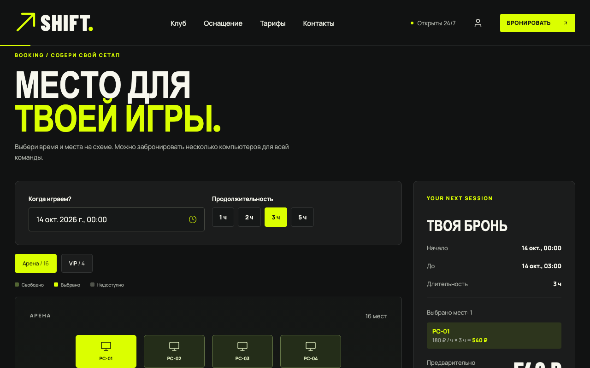
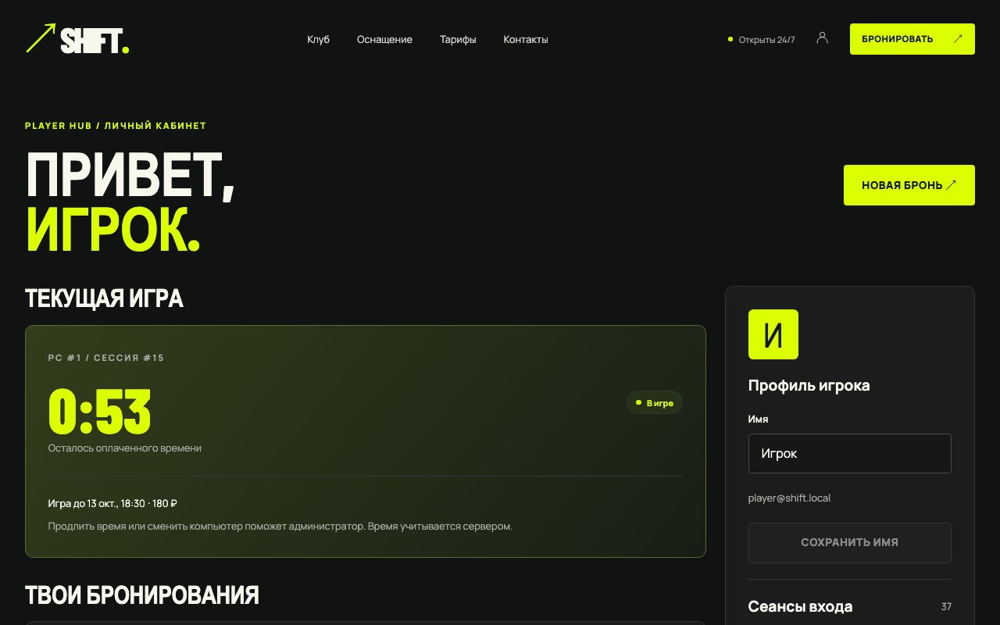
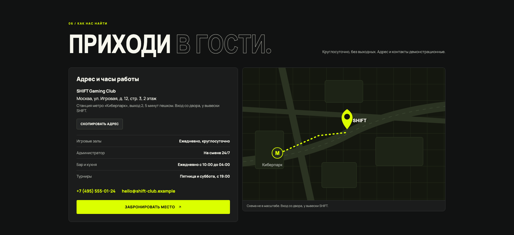
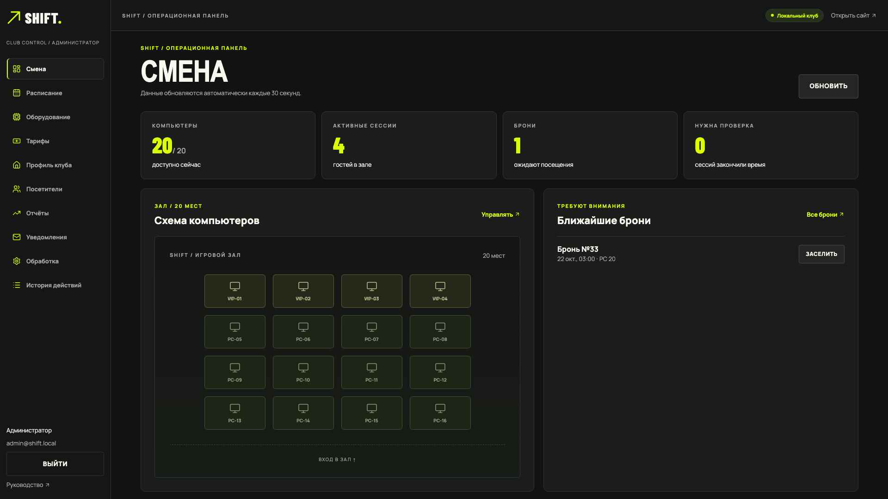
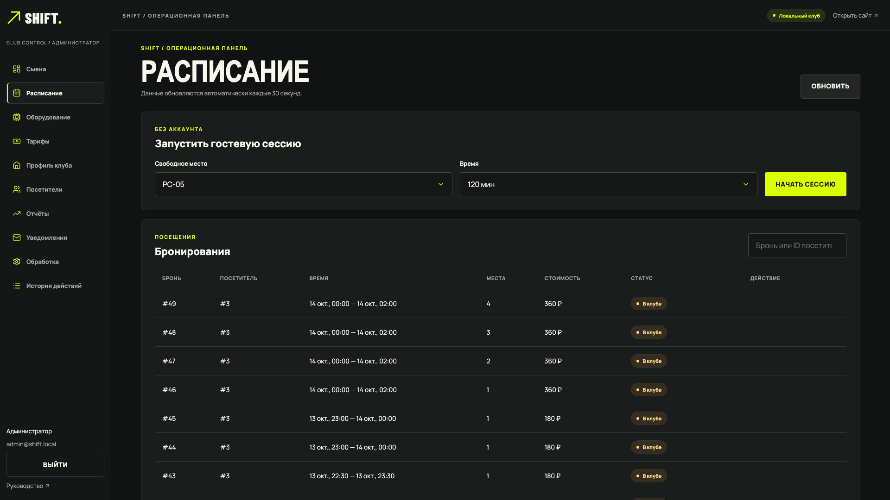
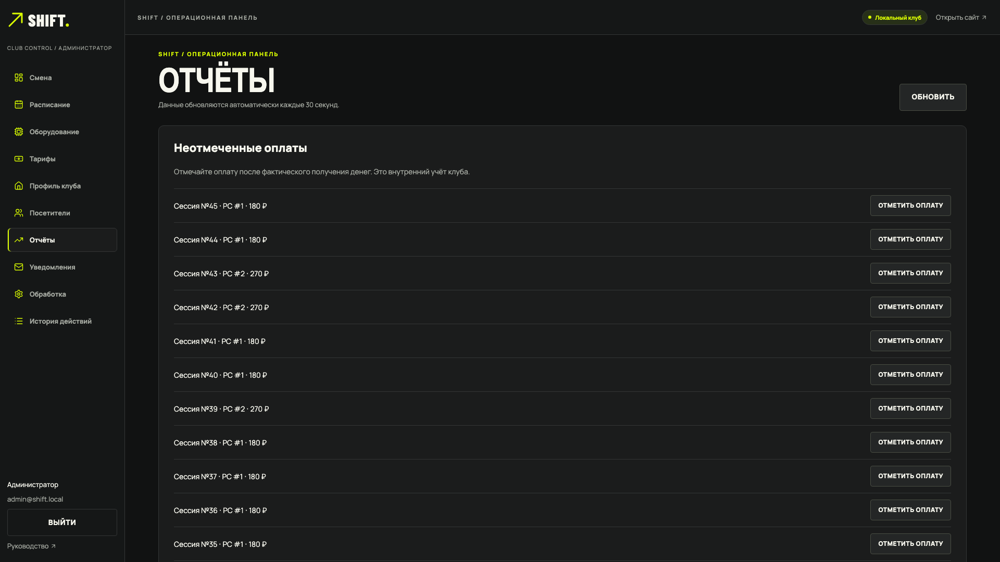
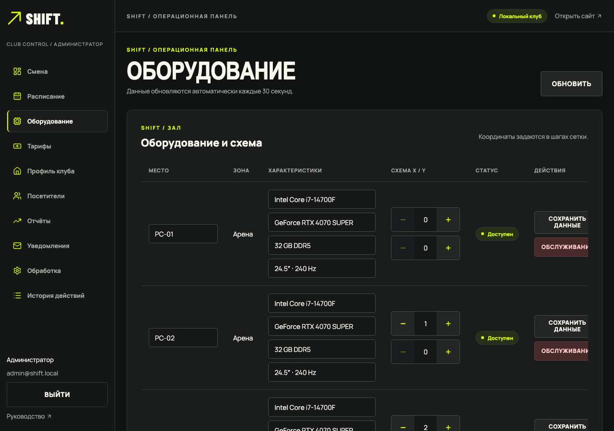

# SHIFT PC Club

Fullstack-проект: система бронирования и управления компьютерным клубом. Публичный сайт с выбором места на схеме зала, личный кабинет игрока и рабочее место администратора, поверх — три независимых backend-сервиса на Laravel с событийным обменом через RabbitMQ.



> Клуб, адрес и контакты вымышленные. Проект рассчитан на локальный запуск; публикации на хостинге нет, платёжный шлюз не подключён (оплата фиксируется в клубе).

## Что умеет

**Для игрока** (`apps/web`)

- Лендинг с анимациями, галереей, тарифами и контактами; SEO и PWA.
- Бронирование: собственный календарь, схема зала с выбором места, итог с расчётом стоимости на сервере.
- Регистрация, вход, восстановление пароля; кабинет с бронями, историей посещений и профилем.

**Для администратора** (`apps/admin`)

- Смена и схема зала: заселение по брони, гостевые сессии, продление, пересадка, оплата, перевод места на обслуживание, неявки и напоминания.
- Расписание, оборудование и зоны, тарифы, профиль клуба.
- Отчёты с выгрузкой CSV для Excel, уведомления, журнал аудита, пользователи.

**Инженерная часть**

- Бронь создаётся в одной транзакции; события пишутся через outbox и обрабатываются идемпотентными consumer-ами (inbox) — см. [ADR](docs/adr/index.md).
- Аутентификация: короткоживущий JWT и вращаемый refresh в HttpOnly-cookie, CSRF, роли проверяются на сервере.
- Конкурентные тесты бронирования, проверка аварийного завершения воркера на живом стеке (`scripts/chaos-worker-kill.sh`).
- Наблюдаемость: Prometheus, Loki, Grafana-дашборды.
- OpenAPI/Swagger для каждого сервиса, Storybook для UI-компонентов, руководства на VitePress.

## Технологии

| Слой           | Стек                                                                          |
| -------------- | ----------------------------------------------------------------------------- |
| Сайт           | Nuxt 4 (SSR), Vue 3, Pinia, TanStack Query, Zod, PWA                          |
| Админка        | Vue 3 + Vite, структура по слоям (entities / features / widgets / pages)      |
| Общие пакеты   | `packages/ui` (компоненты и токены), `packages/contracts` (типы API)          |
| Backend        | Laravel 13, PHP 8.5: сервисы Identity, Club, Booking (+ воркер Booking)       |
| Данные         | PostgreSQL 16 (отдельная база на сервис), Redis 7 (кеш и блокировки)          |
| Сообщения      | RabbitMQ 4 (outbox/inbox)                                                     |
| Инфраструктура | Docker Compose, nginx (единый origin), Mailpit, Grafana, Prometheus, Loki     |
| Качество       | Vitest, Playwright (Chromium и Pixel 7), PHPUnit-тесты, Pint, PHPStan, ESLint |

## Архитектура

```text
Browser → nginx proxy → Nuxt site / Vue admin
                   ├→ Identity API → shift_identity
                   ├→ Club API → shift_club
                   └→ Booking API → shift_booking
                         ↕ RabbitMQ events
             Redis cache/locks · PostgreSQL · Mailpit (local)
```

Каждый сервис владеет только своей базой: Identity — аккаунты и входы, Club — каталог зала и тарифы, Booking — брони, резервирования и игровые сессии. Подробнее — [архитектура](docs/developer/architecture.md), [события](docs/developer/events.md), [ADR](docs/adr/index.md).

## Скриншоты

Сайт и кабинет игрока:

| Выбор даты и времени                                 | Схема зала и итог брони                                 |
| ---------------------------------------------------- | ------------------------------------------------------- |
|  |  |
| **Личный кабинет**                                   | **Контакты**                                            |
|           |            |

Рабочее место администратора:

| Смена                                            | Расписание                                               |
| ------------------------------------------------ | -------------------------------------------------------- |
|     |     |
| **Отчёты**                                       | **Оборудование**                                         |
|  |  |

## Монорепозиторий

Сайт (`apps/web`) и админка (`apps/admin`) — два отдельных приложения, но общий код (`packages/ui`, `packages/contracts`) они берут из одного места через pnpm workspace: `"@shift/ui": "workspace:*"` превращается в символическую ссылку на папку пакета, отдельной сборки и публикации не нужно. Подробно — в [руководстве по фронтенду](docs/developer/frontend.md#как-устроена-связка-пакетов-pnpm-workspace).

## Видеодемо

Запись реального прохода по стенду: бронь игрока → заселение администратором → отчёты.

[shift-demo.webm](https://github.com/user-attachments/assets/c6b059ce-df13-45a3-aeaa-efaa10af8a59)

Перезаписать видео можно командой `node docs/scripts/demo-video.mjs` на запущенном стенде (файл появится в `docs/public/demo/`; по умолчанию CRF 38, около 9 МБ — укладывается в лимит 10 МБ для вставки видео в README на GitHub, при необходимости меняется через `CRF`).

## Документация

[Статус реализации](docs/status.md) · [Руководство игрока](docs/user/index.md) · [Руководство администратора](docs/admin/index.md) · [Разработчику](docs/developer/index.md) · [Домен](docs/domain/index.md) · [ADR](docs/adr/index.md)

## Требования

- Node.js 22 (мажорная версия зафиксирована в `.nvmrc`)
- pnpm 10.12.4 (`corepack enable`, затем `corepack prepare pnpm@10.12.4 --activate`)
- Docker Engine и Docker Compose v2
- PHP 8.5 поставляется образом backend; Composer 2 включён в него

## Два способа запуска

|                         | `./scripts/start.sh`                             | `./scripts/setup.sh` + `./scripts/dev.sh`               |
| ----------------------- | ------------------------------------------------ | ------------------------------------------------------- |
| Для чего                | посмотреть и показать проект, как на сервере     | разрабатывать фронтенд и backend                        |
| Фронтенд                | собранный (production) и запущенный **в Docker** | dev-серверы **на вашей машине** с горячей перезагрузкой |
| Что нужно на машине     | только Docker                                    | Docker, Node 22, pnpm                                   |
| Storybook               | `/storybook/` на порту 8088                      | `http://localhost:6006/`                                |
| Подготовительный скрипт | не нужен (всё делает сам, включая `bootstrap`)   | `setup.sh` один раз                                     |

`scripts/bootstrap.mjs` — внутренний шаг обоих способов: создаёт `.env` со случайными секретами, ключи подписи JWT и `.env` сервисов; существующие значения не трогает. Запускать его отдельно не нужно.

## Быстрый старт: всё одной командой в Docker

Нужен только Docker (Node, PHP и pnpm на машине не требуются):

```sh
./scripts/start.sh               # сайт, админка, документация, API, брокер и базы
./scripts/start.sh --monitoring  # то же плюс Grafana, Prometheus и Loki
```

Скрипт сам создаёт `.env` с секретами и ключи JWT, ставит зависимости в контейнерах, применяет миграции, заполняет демо-данные и запускает воркеры. В конце он печатает адреса и учётные данные. Повторный запуск безопасен: существующие секреты и данные сохраняются.

**Тестовые аккаунты** (создаются только локально):

| Роль          | Email                | Пароль           | Где входить                  |
| ------------- | -------------------- | ---------------- | ---------------------------- |
| Администратор | `admin@shift.local`  | `ShiftDemo2026!` | http://localhost:8088/admin/ |
| Игрок         | `player@shift.local` | `ShiftDemo2026!` | http://localhost:8088/auth   |

**Режим запуска.** В `.env` переменная `SHIFT_MODE`: `dev` (по умолчанию) — для разработки и автотестов: лимиты на вход и запросы подняты, заселять по брони можно за 30 дней до начала; `prod` — строгие правила (10 попыток входа и 120 запросов в минуту, заселение за 15 минут до начала). Строгий режим: `SHIFT_MODE=prod ./scripts/start.sh`.

**Grafana:** http://localhost:3038/ (профиль monitoring), логин `admin`, пароль — `GRAFANA_PASSWORD` из `.env`. RabbitMQ: http://localhost:15678/, логин и пароль — `RABBITMQ_USER` и `RABBITMQ_PASSWORD` из `.env`. Как работать с Grafana и журналами — в `docs/developer/monitoring.md`.

Для разработки (горячая перезагрузка, тесты) используйте режим ниже: `./scripts/setup.sh` и `./scripts/dev.sh`.

## Локальная установка

```sh
./scripts/setup.sh
./scripts/dev.sh
```

Setup создаёт игнорируемые локальные файлы окружения и ключи, устанавливает зависимости, собирает образ PHP, создаёт локальные базы, выполняет миграции и локальные сидеры и запускает сервисы. Храните `.env`, `.runtime/`, сгенерированные ключи и локальные данные в тайне. Не используйте в демо реальные персональные данные и боевые учётные данные.

Для проверки продакшен-сборок фронтенда вместо `./scripts/dev.sh` используйте `./scripts/preview.sh`: он собирает web и admin и запускает их на тех же портах (3000 и 5173), на которые смотрит прокси. Два скрипта одновременно не запускайте.

Продакшен-сборку фронтенда можно запустить целиком в Docker, без dev-серверов на хосте:

```sh
SHIFT_PROXY_CONF=nginx.prod.conf docker compose --profile prod up -d --build web static proxy
```

Сервис `web` — собранный Nuxt (Node), `static` — nginx с админкой (`/admin/`) и руководствами (`/docs/`); прокси переключается на `infra/proxy/nginx.prod.conf` и находит их по именам сервисов. Storybook в этот набор входит и открывается по `/storybook/`. Вернуться к разработке: `docker compose up -d proxy` (без переменной) и `./scripts/dev.sh`.

Адреса:

- Сайт и API-прокси: <http://localhost:8088/>
- Бронирование: <http://localhost:8088/booking>
- Кабинет игрока: <http://localhost:8088/account>
- Рабочее место персонала: <http://localhost:8088/admin/>
- Руководства разработчика: <http://localhost:8088/docs/>
- Storybook (каталог UI-компонентов): <http://localhost:6006/> при запуске `./scripts/dev.sh`; в продакшен-режиме Docker (`./scripts/start.sh`) — <http://localhost:8088/storybook/>
- Swagger UI: `/docs/api/identity/`, `/docs/api/club/`, `/docs/api/booking/`; спецификации: `/api/auth/openapi.json`, `/api/club/openapi.json`, `/api/booking/openapi.json`
- Управление RabbitMQ: <http://localhost:15678/>; учётные данные — в игнорируемом локальном `.env`
- Mailpit: <http://localhost:8028/>
- Grafana (при запущенном профиле monitoring): <http://localhost:3038/>

Локальные демо-аккаунты (создаются только в окружениях `local` и `testing`):

| Роль          | Email                | Пароль           |
| ------------- | -------------------- | ---------------- |
| Администратор | `admin@shift.local`  | `ShiftDemo2026!` |
| Игрок         | `player@shift.local` | `ShiftDemo2026!` |

Игрок также может зарегистрироваться через `/auth`. Для бронирования нужен вход. Стоимость брони рассчитывает и фиксирует сервер; оплата фиксируется в клубе, платёжный шлюз не подключён. Администратор запускает сессии и управляет ими в рабочем месте операций.

## Полезные команды

```sh
pnpm install --frozen-lockfile
pnpm lint
pnpm format:check
pnpm typecheck
pnpm test:unit
pnpm test:e2e
pnpm build
docker compose --profile monitoring up -d
docker compose logs -f identity club booking booking-worker
docker compose down                 # сохраняет тома локальных баз
docker compose down -v              # удаляет локальные базы и данные мониторинга
```

`pnpm build` собирает web, admin, Storybook и документацию VitePress. Помощники для backend — `scripts/backend.sh` и `scripts/check.sh`; перед запуском изучите их параметры.

## Изоляция тестовых баз backend

Когда контейнер PostgreSQL запущен и три базы `shift_*_test` уже существуют, один раз выполните `python3 scripts/isolate-test-databases.py`, чтобы настроить выделенные роли. Команде нужен административный доступ к PostgreSQL; она меняет только владельцев тестовых баз и объектов и правила аутентификации тестовых ролей. Она не создаёт и не удаляет базы, не запускает миграции и не удаляет данные.

Скрипт генерирует отдельные `IDENTITY_TEST_DB_PASSWORD`, `CLUB_TEST_DB_PASSWORD` и `BOOKING_TEST_DB_PASSWORD` в игнорируемом `.runtime/test-db.env` (режим 600). Держите файл приватным. `scripts/backend.sh` читает значения без выполнения файла; явно заданные переменные окружения имеют приоритет. Каждая тестовая роль ограничена своей базой через ACL и правила `pg_hba.conf`. Скрипт проверяет аутентифицированные подключения, отказ в подключении к другим базам и неизменность владельцев и ACL демо-баз.

Тесты backend можно запускать автоматически (`scripts/backend.sh test [service]`) только на этих выделенных тестовых базах: охранники Laravel отклоняют небезопасную конфигурацию до запуска трейтов миграций. Конфигурация PostgreSQL перезагружается без перезапуска контейнеров. После создания нового тома PostgreSQL настройте изоляцию заново; никогда не удаляйте существующий том ради запуска тестов.

Лимит входа и регистрации — 10 попыток в минуту с одного IP. Если E2E-набор упирается в него (код 429), перезапустите сервисы с `AUTH_RATE_LIMIT=200 API_RATE_LIMIT=1000 docker compose up -d identity club booking` (общий лимит API — 120 запросов в минуту); в проверках безопасности лимит оставляйте по умолчанию.

## Демо-контент и иллюстрации

Адрес, часы работы и контакты клуба — вымышленные демо-данные (сидер Club, редактируются в админке: «Профиль клуба»). Иллюстрации галереи (`apps/web/public/images/gallery/*.svg`) нарисованы кодом: чтобы пересоздать их, выполните `python3 scripts/generate-images.py`.

## Устранение неполадок

- Если setup сообщает об отсутствующих значениях окружения, запустите `./scripts/setup.sh` снова — он создаёт локальную конфигурацию. Не копируйте реальный файл окружения в репозиторий.
- Если страница отдаёт 502, проверьте `docker compose ps`, затем `docker compose logs identity club booking proxy`; убедитесь, что `./scripts/dev.sh` запускает dev-серверы фронтенда.
- Если порт занят, задайте `SHIFT_HTTP_PORT` в игнорируемом корневом `.env` (по умолчанию 8088) и пересоздайте `proxy`.
- Если просмотр документации и API не загружает схему, проверьте, что API-сервис здоров и маршрут OpenAPI включён. Кнопка Swagger Try it out меняет локальные демо-данные.
- Чтобы сбросить демо-данные, остановите стек и удалите локальные тома `docker compose down -v`, затем повторите setup. Это удалит все локальные базы и данные мониторинга.

## Карта проекта

- `apps/web/` — публичный SSR-сайт, бронирование, авторизация и кабинет игрока
- `apps/admin/` — рабочее место персонала
- `packages/ui/` — общие компоненты Vue и дизайн-токены
- `packages/contracts/` — общие типы API
- `services/*/` — сервисы Laravel и их миграции
- `infra/` — конфигурация Compose, прокси, PostgreSQL, RabbitMQ и мониторинга
- `docs/` — руководства VitePress и просмотр API
