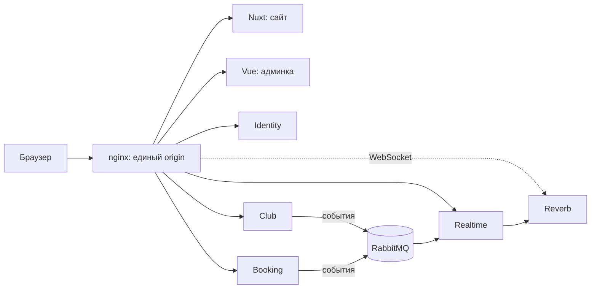
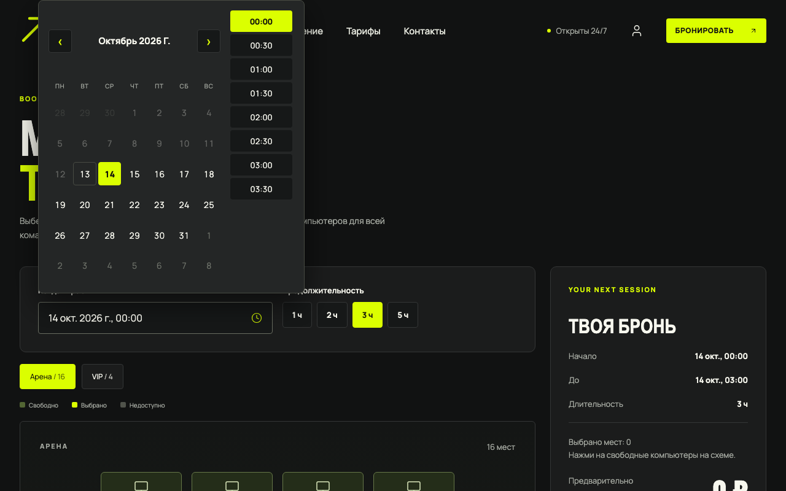
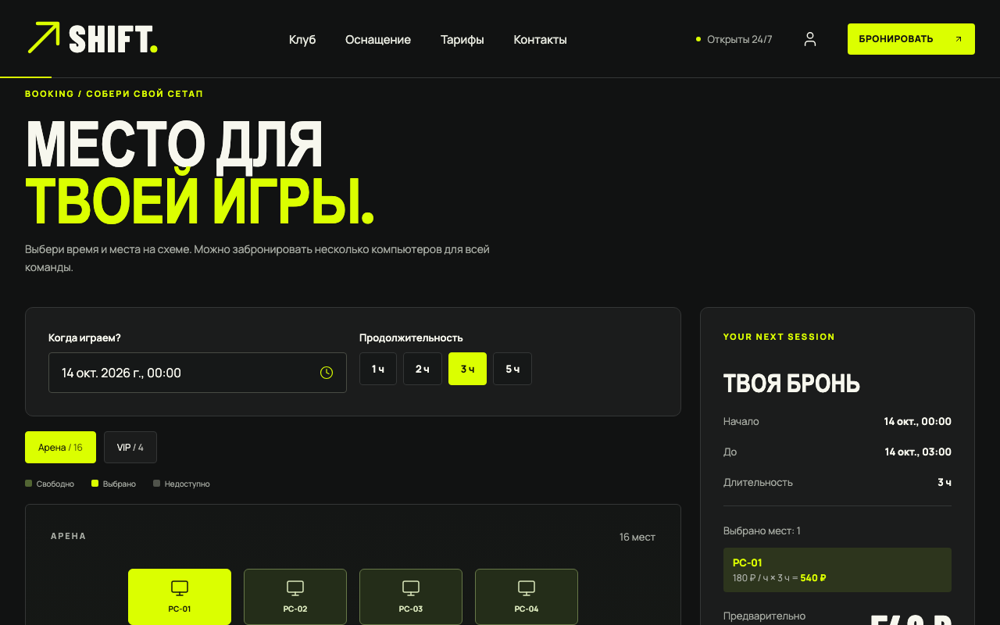
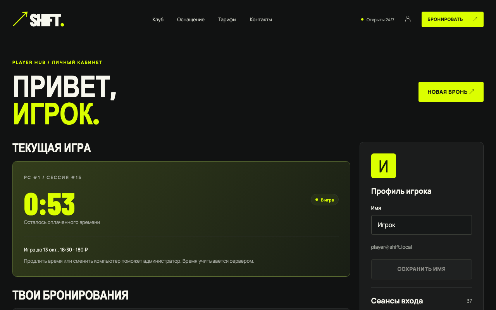
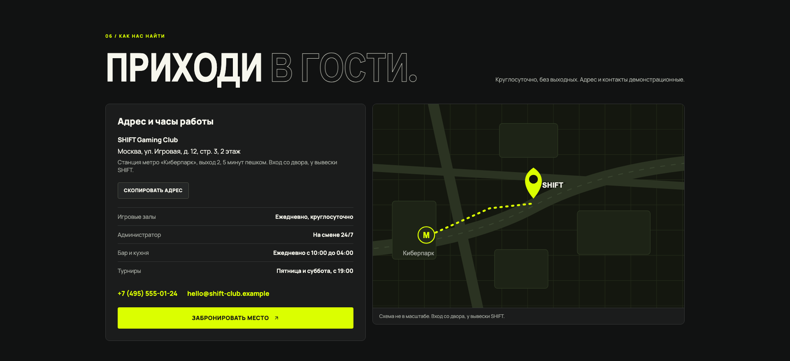
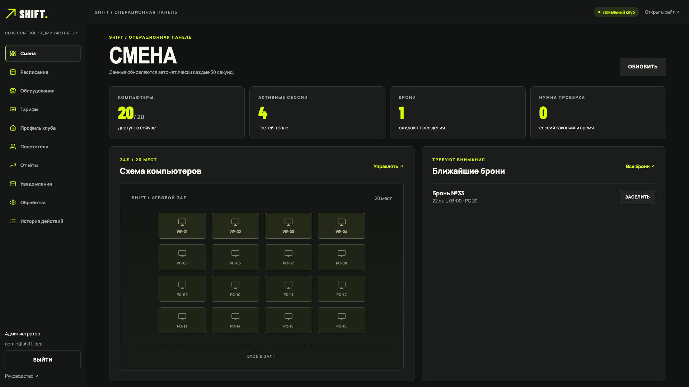
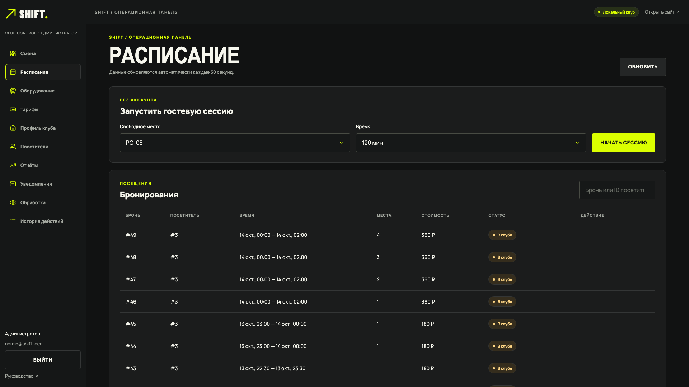
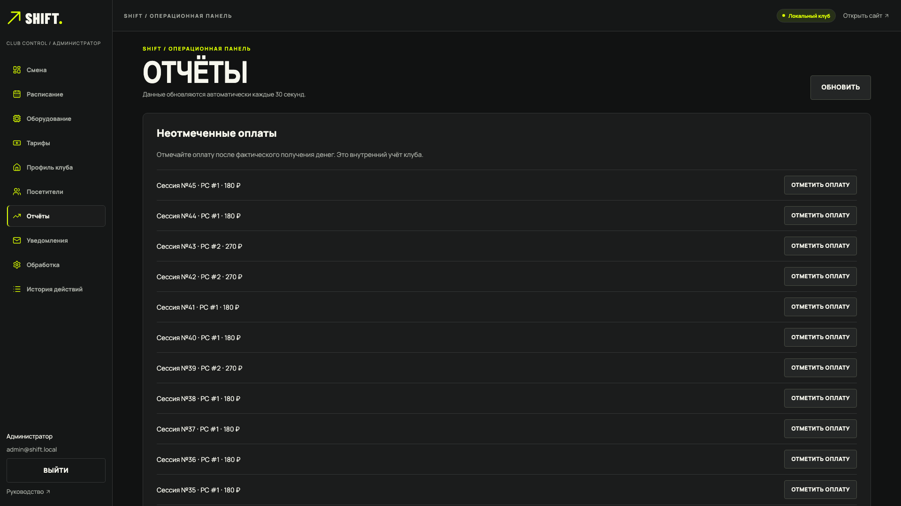
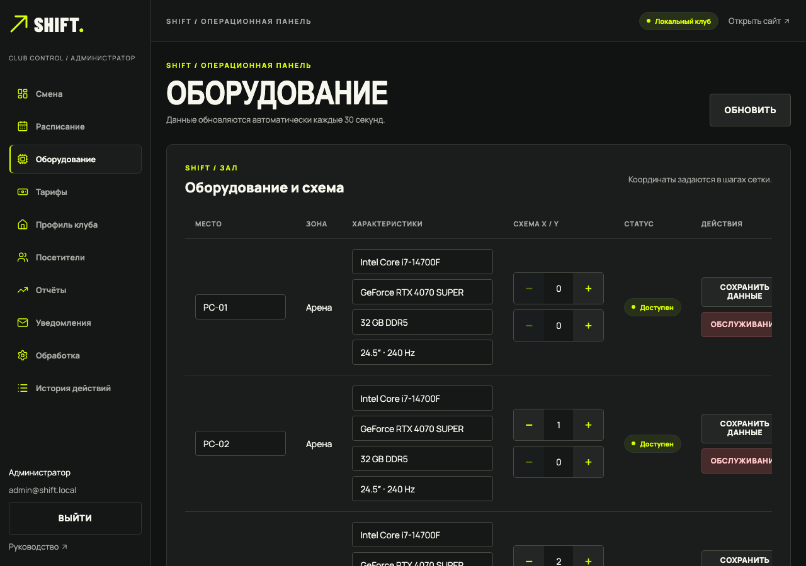

<div align="center">

# 🎮 SHIFT PC Club

**Бронирование и управление компьютерным клубом: от выбора места на схеме зала до смены администратора и закрытых жалоб владельцу.**

[](https://github.com/bone1nis/shift-pc-club/actions/workflows/quality.yml)


[С чего начать](#с-чего-начать-читать) · [Быстрый старт](#быстрый-старт-всё-одной-командой-в-docker) · [Что умеет](#что-умеет) · [Архитектура](#архитектура) · [Видеодемо](#видеодемо) · [Документация](#документация)

</div>

[01-landing.webm](https://github.com/user-attachments/assets/e31cd999-beed-44ba-97d0-f9a350674eb0)

> Клуб, адрес и контакты вымышленные. Проект рассчитан на локальный запуск; публикации на хостинге нет, платёжный шлюз не подключён (оплата фиксируется в клубе).

## Коротко

|                             |                                                                                      |
| --------------------------- | ------------------------------------------------------------------------------------ |
| 🗺️ **Схема зала**           | Игрок видит свободные места и бронирует без звонка; двойная бронь невозможна         |
| 🖥️ **Смена администратора** | Заселение, продление, пересадка, оплата и неявки в одном окне, экран обновляется сам |
| 💬 **Чат брони**            | Компания в одном чате; секретные сообщения шифруются на устройстве (E2E)             |
| 🔒 **Жалобы владельцу**     | Читает только владелец: клуб технически не может расшифровать                        |
| 📊 **Отчёты**               | Загрузка, воронка от просмотра сайта до брони, выгрузка в Excel                      |
| 🧱 **Инженерная часть**     | 4 сервиса, outbox/inbox через RabbitMQ, WebSocket-сигналы, наблюдаемость, ADR        |



## С чего начать читать

Сначала поднимите проект: `./scripts/start.sh`, затем http://localhost:8088/. Дальше выберите свою роль.

### 🎨 Фронтенд

- **Код:** `apps/web` (сайт, Nuxt) и `apps/admin` (Vue). Слои FSD: `pages`, `features`, `widgets`, `entities`, `shared`.
- **Общее:** `packages/ui` (компоненты, токены, Storybook на `/storybook/`) и `packages/contracts` (типы API).
- **Почитать:** [Фронтенд](docs/developer/frontend.md), [Библиотеки](docs/developer/libraries.md).
- **Интересное:** `features/booking-chat` (чат и E2E в интерфейсе), `packages/ui/src/lib/realtime.ts` (WebSocket-клиент), `packages/e2ee` (Web Crypto).
- **Проверка:**

```sh
pnpm lint
pnpm typecheck
pnpm test:coverage
```

### ⚙️ Backend

- **Код:** `services/{identity,club,booking,realtime}`. Путь запроса: `routes/api.php` → `Controllers` → `Services`. Тесты: `tests/Feature`.
- **Почитать:** [Сервисы backend](docs/developer/services/index.md), [Outbox и inbox](docs/developer/events.md), [ADR](docs/adr/index.md).
- **Интересное:** `booking/app/Services/ReservationService.php` (бронь одной транзакцией), `Outbox.php` и `EventHandler.php` (outbox и inbox), `services/realtime` (Reverb и права на каналы).
- **Полезно:** [Mailpit](http://localhost:8028/) (письма), [RabbitMQ](http://localhost:15678/) (очереди).
- **Проверка:**

```sh
./scripts/backend.sh lint
./scripts/backend.sh analyse
./scripts/backend.sh test
```

### 🧩 Фулстек и ревью

- **Начните с контракта:** `packages/contracts` общий для фронта и бэка (Zod).
- **Почитать:** [Архитектура](docs/developer/architecture.md), [Почему так](#почему-всё-устроено-именно-так), [Ограничения безопасности](#ограничения-модели-безопасности).
- **Путь брони:** форма → `POST /api/booking/bookings` → outbox → RabbitMQ → Realtime → WebSocket-сигнал → кабинет.
- **Проверка:** `./scripts/check.sh all`, e2e: `pnpm test:e2e`.

Папки — в [карте проекта](#карта-проекта), руководства — в [документации](#документация).

## Зачем это нужно

**Проблема.** Небольшой компьютерный клуб обычно живёт на звонках, мессенджерах и тетради администратора. Отсюда типичные сбои: два человека договорились на одно место, компания не пришла и место простояло пустым, администратор в конце смены сводит оплату и время вручную, а владелец не видит, что на самом деле происходит в зале.

**Что меняет продукт.**

- **Игроку** не нужно звонить: он видит свободные места на схеме зала, бронирует на удобное время, заранее знает цену и приглашает друзей в чат брони.
- **Администратору** в смену вся картина зала в одном окне: кто пришёл, кто не явился, где закончится время, какое место на обслуживании. Заселение, продление, пересадка и оплата делаются в несколько нажатий, а экран сам обновляется.
- **Владельцу** доступны отчёты (загрузка, воронка от просмотра сайта до брони, выгрузка в Excel), журнал действий и закрытый канал для жалоб и отзывов, который не может прочитать даже администратор.

**Принципы.**

- Одно место нельзя забронировать дважды: это гарантирует сервер, а не договорённость.
- Деньги принимаются в клубе, поэтому онлайн-оплаты нет намеренно: меньше рисков и нет платёжного шлюза.
- Приватное остаётся приватным: секретные сообщения и жалобы шифруются на устройстве.
- Сбой одной части (почта, брокер, воркер) не должен ломать бронирование: события дождутся восстановления.

**Для кого.** Небольшой клуб на 10–50 мест с одним-двумя администраторами в смену и владельцем. Это не сеть клубов и не облачная система учёта: один клуб, одна схема зала.

## Что умеет

**Для игрока** (`apps/web`)

- Лендинг с анимациями, галереей, тарифами и контактами; SEO и PWA.
- Бронирование: собственный календарь, схема зала с выбором места, итог с расчётом стоимости на сервере.
- Регистрация, вход, восстановление пароля; кабинет с бронями, историей посещений и профилем.
- Чат брони для компании (с модерацией и секретными сообщениями) и жалобы или отзывы владельцу с E2E-шифрованием.

**Для администратора** (`apps/admin`)

- Смена и схема зала: заселение по брони, гостевые сессии, продление, пересадка, оплата, перевод места на обслуживание, неявки и напоминания.
- Расписание, оборудование и зоны, тарифы, профиль клуба.
- Отчёты с выгрузкой CSV для Excel, уведомления, журнал аудита, пользователи.
- Карта зала и счётчики обновляются по WebSocket-сигналам, а не опросом.

**Для владельца** (`apps/admin`, роль `owner`)

- Права администратора плюс раздел «Жалобы»: расшифровка на клиенте, статусы, ключ владельца и код восстановления.

**Инженерная часть**

- Бронь создаётся в одной транзакции; события пишутся через outbox и обрабатываются идемпотентными consumer-ами (inbox) — см. [ADR](docs/adr/index.md).
- Аутентификация: короткоживущий JWT и вращаемый refresh в HttpOnly-cookie, CSRF, роли проверяются на сервере.
- Конкурентные тесты бронирования, проверка аварийного завершения воркера на живом стеке (`scripts/chaos-worker-kill.sh`).
- Наблюдаемость: Prometheus, Loki, Grafana-дашборды.
- OpenAPI/Swagger для каждого сервиса, Storybook для UI-компонентов, руководства на VitePress.

## Технологии

| Слой           | Стек                                                                          |
| -------------- | ----------------------------------------------------------------------------- |
| Сайт           | Nuxt 4 (SSR), Vue 3, Pinia, TanStack Query, Zod, PWA                          |
| Админка        | Vue 3 + Vite, структура по слоям (entities / features / widgets / pages)      |
| Общие пакеты   | `packages/ui` (компоненты и токены), `packages/contracts` (типы API)          |
| Backend        | Laravel 13, PHP 8.5: сервисы Identity, Club, Booking, Realtime (+ воркеры)    |
| Realtime       | Laravel Reverb (WebSocket, протокол Pusher), Laravel Echo + pusher-js         |
| Шифрование     | `packages/e2ee` на Web Crypto (ECDH P-256, HKDF, AES-GCM)                     |
| Данные         | PostgreSQL 16 (отдельная база на сервис), Redis 7 (кеш, блокировки, pub/sub)  |
| Сообщения      | RabbitMQ 4 (outbox/inbox)                                                     |
| Инфраструктура | Docker Compose, nginx (единый origin), Mailpit, Grafana, Prometheus, Loki     |
| Качество       | Vitest, Playwright (Chromium и Pixel 7), PHPUnit-тесты, Pint, PHPStan, ESLint |

## Архитектура

```text
Browser → nginx proxy → Nuxt site / Vue admin
                   ├→ Identity API → shift_identity
                   ├→ Club API → shift_club
                   ├→ Booking API → shift_booking
                   ├→ Realtime API → shift_realtime (чат, ключи устройств)
                   └→ WebSocket /app/ → Reverb
                         ↕ RabbitMQ events
 Redis cache/locks/pub-sub · PostgreSQL · Mailpit (local)
```

Realtime-часть состоит из четырёх контейнеров: `realtime` (HTTP API, :8000 внутри сети), `reverb` (WebSocket-сервер, :8080 внутри сети), `realtime-worker` (`events:consume`: слушает RabbitMQ и рассылает сигналы) и `realtime-scheduler` (очистка вложений и секретов по сроку). Наружу порты не публикуются: браузер ходит через прокси на :8088 — API по `/api/realtime/`, WebSocket по `/app/`. Жалобы живут в Club, а не в Realtime.

Каждый сервис владеет только своей базой: Identity — аккаунты и входы, Club — каталог зала, тарифы и жалобы (шифртекст), Booking — брони, резервирования и игровые сессии, Realtime — чат брони, участники и ключи устройств. Подробнее — [архитектура](docs/developer/architecture.md), [события](docs/developer/events.md), [ADR](docs/adr/index.md).

## Почему всё устроено именно так

Для одного клуба такая схема избыточна, и это осознанно: проект учебно-демонстрационный, и в нём показаны приёмы, которые нужны на реальных нагрузках. Каждое решение ниже можно заменить на простое, если проект будет жить как обычное приложение. Полные обоснования — в [ADR](docs/adr/index.md).

| Решение                                     | Что даёт                                                                                                                                     | Чем платим                                                                     |
| ------------------------------------------- | -------------------------------------------------------------------------------------------------------------------------------------------- | ------------------------------------------------------------------------------ |
| Четыре сервиса, у каждого своя база         | Изолированные сбои и права, независимые релизы и тесты ([ADR 0003](docs/adr/0003-database-per-service.md))                                   | Нет общих join-ов, больше контейнеров и конфигурации                           |
| RabbitMQ + outbox/inbox                     | Событие не теряется, если сервис упал между записью в базу и отправкой; дубли безопасны ([ADR 0002](docs/adr/0002-rabbitmq-outbox-inbox.md)) | Доставка «хотя бы раз», получатели обязаны быть идемпотентными                 |
| Бронь одной транзакцией                     | Два человека не займут одно место ([ADR 0004](docs/adr/0004-booking-reservation-in-one-transaction.md))                                      | Booking держит копию каталога из Club                                          |
| JWT в HttpOnly-cookie + CSRF                | Токен не прочитать из JavaScript, защита от XSS-кражи сеанса ([ADR 0001](docs/adr/0001-jwt-http-only-cookies.md))                            | Нужен CSRF-токен на каждый изменяющий запрос                                   |
| Единый origin через nginx                   | Нет CORS, cookie работают без хитростей, внутренние пути закрыты на прокси                                                                   | Прокси — обязательная часть стека                                              |
| WebSocket только как сигнал, данные по REST | Потерянный сигнал ничего не ломает, права проверяются в одном месте ([ADR 0007](docs/adr/0007-reverb-and-e2ee.md))                           | Лишний запрос после каждого сигнала; опрос остаётся фолбэком                   |
| E2E-шифрование секретов и жалоб             | Клуб технически не может прочитать секретное сообщение или жалобу                                                                            | Нельзя модерировать; потеря ключа владельца без кода восстановления необратима |
| `packages/contracts` (Zod)                  | Один источник правды для фронта, бэка и событий; несовместимость видна в тестах                                                              | Изменения API надо вносить через контракт                                      |
| Nuxt (SSR) для сайта, Vite для админки      | Сайту нужны SEO и быстрая первая отрисовка, админке — нет                                                                                    | Два фронтенда вместо одного                                                    |
| Prometheus, Loki, Grafana                   | Видно очередь outbox, задержки и ошибки воркеров                                                                                             | Опциональный профиль `--monitoring`, ест память                                |

### Что здесь избыточно и зачем оно всё равно есть

Для реального клуба часть решений была бы лишней, и лучше сказать это прямо:

- **E2E-шифрование чата и жалоб.** Клубу незачем скрывать от себя переписку игроков, а администратор обычно как раз должен её модерировать. Реальному клубу хватило бы TLS и обычного хранения в базе. Здесь E2E сделано, чтобы показать, как это строится: ключи на устройствах, конверты на несколько устройств, сверка отпечатков, код восстановления. Цена видна: секреты нельзя модерировать, а потеря ключа владельца без кода необратима. Поэтому обычный чат оставлен открытым и модерируемым, а шифруются только сообщения `kind=secret` и жалобы.
- **Четыре сервиса и RabbitMQ.** Один Laravel-монолит с одной базой справился бы с нагрузкой клуба и был бы проще в поддержке. Разделение показывает границы данных, события и идемпотентность на практике.
- **WebSocket.** Опроса раз в 30 секунд для зала хватало бы. Reverb добавлен ради живых обновлений и чата, при этом опрос остаётся фолбэком.

Если проект станет настоящим продуктом, начинать упрощать стоит с этого списка.

## Realtime

Вместо опроса раз в 30 секунд кабинет игрока и смена в админке получают по WebSocket короткий сигнал (`account.changed`, `hall.changed`) и после него запрашивают данные через обычный REST. Данные по WebSocket не передаются, поэтому потерянный сигнал ничего не ломает. Опрос остаётся фолбэком: раз в 120 секунд при живом соединении и раз в 30 секунд, когда WebSocket отключён. Клиент сам переподключается (1 → 30 с) и переподписывается на каналы. Каналы приватные, права проверяет `POST /api/realtime/broadcasting/auth` по тому же JWT-cookie и CSRF, что и остальной API.

Запуск realtime-части отдельно (остальной стек должен быть поднят):

```sh
docker compose up -d realtime reverb realtime-worker realtime-scheduler
scripts/backend.sh test realtime        # тесты сервиса на выделенной тестовой базе
```

Секреты `REVERB_APP_ID/KEY/SECRET` создаёт `scripts/bootstrap.mjs`; `./scripts/start.sh` и `./scripts/dev.sh` поднимают всё сами.

## Чат брони

У брони есть чат для компании. Владелец брони приглашает друзей одноразовой ссылкой `/invite/<токен>` (действует 72 часа, токен в базе хранится только как хеш) — друг входит под своим аккаунтом. Есть «кто в сети», «печатает…», «прочитано» и вложения-картинки (до 10 МБ). После отмены или завершения брони чат закрывается для записи, история остаётся читаемой; вложения чистятся через 30 дней.

Обычные сообщения хранятся текстом и **модерируются**: администратор и владелец клуба читают чат любой брони (писать не могут), администратор может удалить сообщение или заглушить участника. Это сказано и в интерфейсе.

Для паролей и кодов есть кнопка «Секрет»: такое сообщение шифруется в браузере под ключ каждого устройства каждого участника, сервер хранит только шифртекст и конверты, модератор видит лишь факт секрета и может удалить его. Расшифровка по нажатию, новый участник или устройство старые секреты не прочитают, через 24 часа после закрытия брони секреты удаляются. Отпечатки участников можно сверить прямо в чате.

## Жалобы и отзывы владельцу

Форма `/account/feedback`: категория, оценка 1–5, текст, необязательная привязка к брони и флажок «показать моё имя». Всё, кроме категории, оценки и статуса, шифруется в браузере под открытый ключ владельца; в запросе нет открытого текста, а `user_id` хранится только для лимита (5 в сутки) и никому не отдаётся. Администратор этот раздел не видит, его API отвечает 403.

Владелец (`owner@shift.local`) при первом входе создаёт ключ: приватный ключ остаётся в его браузере (IndexedDB, non-extractable), а зашифрованная копия уходит на сервер. **Код восстановления** показывается один раз; по нему ключ восстанавливается на новом устройстве. Если код потерян, а ключа на устройстве нет, на экране восстановления есть «Не помню код — создать новый ключ»: новые жалобы пойдут под новый ключ, а зашифрованные прежним прочитать будет нельзя. Отпечаток ключа владельца показан в форме жалобы: игрок сверяет его с тем, что сообщил владелец лично. При смене ключа форма предупреждает и блокирует отправку. О новой жалобе владельцу приходит сигнал `complaint.created` (бейдж в админке) и письмо «Новая жалоба или отзыв» с номером и ссылкой на `/admin/complaints`, без текста, категории, оценки и автора. Письмо отправляет realtime-worker после обработки события (адреса активных владельцев берёт у Identity по внутреннему токену); при сбое оно не повторяется.

## Ограничения модели безопасности

**Роли и входы.** Сайт и админка живут на одном origin и делят cookie сеанса, поэтому вход один. Разделение идёт по роли, а не по сеансу: игрок, открыв `/admin/`, сразу уходит на сайт и интерфейс админки не видит; гость попадает на форму входа админки; `admin` и `owner` работают в админке, а раздел «Жалобы» открыт только `owner`. Права при этом проверяет сервер (роль из Identity), а не фронтенд. Отдельные сеансы для админки не делались (см. [архитектуру](docs/developer/architecture.md#роли-и-входы)).

Относится к жалобам и секретным сообщениям. Честно о том, чего E2E здесь не даёт:

- **Это E2E уровня браузера.** Код шифрования присылает тот же сервер, что и страницу. Скомпрометированный сервер может отдать вредоносный JS. Закрывается только установленным приложением, для проекта это принято.
- **Подмена ключа** (владельца или участника чата) заметна только при сверке отпечатков. Не сверили — защиты нет.
- **Метаданные видны серверу:** кто, когда, в какой брони, категория, оценка, размер сообщений, список участников.
- **Нет forward secrecy:** утечка приватного ключа владельца или устройства раскрывает всё, что под ним зашифровано.
- **Потеря ключа и кода восстановления означает потерю жалоб.** Сервер помочь не может. У каждой ротации ключа свой код: старые жалобы на чистом устройстве открываются только старыми кодами.
- **Нет паддинга длины:** по размеру шифртекста можно прикинуть длину сообщения.
- **Non-extractable не защищает от XSS:** вредоносный скрипт на странице не вынет ключ, но сможет вызвать расшифровку от имени пользователя.
- **Конверты не подписаны отправителем.** Тот, кто контролирует сервер, может переатрибутировать автора секретного сообщения.
- **Сервер может добавить «устройство» на ваш аккаунт** (списка своих устройств в интерфейсе пока нет), и следующие секреты будут шифроваться и под него. Помогает сверка отпечатков.
- **Обычный чат не E2E.** Шифруются только секретные сообщения, поэтому остальное читается сервером, администраторами и модерируется.
- **Скриншот и копирование защитить нельзя**; жалобы не модерируются (сервер не видит текст), страховка — лимиты.

## Скриншоты

Сайт и кабинет игрока:

| Выбор даты и времени                                 | Схема зала и итог брони                                 |
| ---------------------------------------------------- | ------------------------------------------------------- |
|  |  |
| **Личный кабинет**                                   | **Контакты**                                            |
|           |            |

Рабочее место администратора:

| Смена                                            | Расписание                                               |
| ------------------------------------------------ | -------------------------------------------------------- |
|     |     |
| **Отчёты**                                       | **Оборудование**                                         |
|  |  |

## Монорепозиторий

Сайт (`apps/web`) и админка (`apps/admin`) — два отдельных приложения, но общий код (`packages/ui`, `packages/contracts`) они берут из одного места через pnpm workspace: `"@shift/ui": "workspace:*"` превращается в символическую ссылку на папку пакета, отдельной сборки и публикации не нужно. Подробно — в [руководстве по фронтенду](docs/developer/frontend.md#как-устроена-связка-пакетов-pnpm-workspace).

## Видеодемо

Короткие фрагменты реального прохода по стенду, 1080p, 60 к/с. Полный проход на две минуты — в первом ролике ниже.

**Полное демо (2 минуты): лендинг, бронь игрока, смена администратора**

[demo.webm](https://github.com/user-attachments/assets/e9e00fae-cf0c-4092-8373-00e6e59ded99)

**Бронирование**

[02-booking.webm](https://github.com/user-attachments/assets/c885eeed-3db7-4f45-9de2-795679da1a1f)

**Кабинет обновляется сам (WebSocket-сигналы)**

[03-realtime-cabinet.webm](https://github.com/user-attachments/assets/73528952-35b6-4bdd-9e39-6cffafbcdcf5)

**Живая карта зала в админке**

[04-hall-live.webm](https://github.com/user-attachments/assets/5e47ce74-6748-44e5-bd9a-3a35a8923196)

**Чат брони и секретное сообщение**

[05-chat.webm](https://github.com/user-attachments/assets/8280ad02-a294-4656-bc20-b8d1553211f1)

**Жалоба владельцу (E2E)**

[06-complaint.webm](https://github.com/user-attachments/assets/2f97bcda-2271-46fe-b551-1f9e668f8249)

Записать заново: `node docs/scripts/demo-video.mjs` на запущенном стенде (нужны Node 22 и `cwebp`/`img2webp`, на macOS они в `/opt/homebrew/bin`). Один клип: `node docs/scripts/demo-video.mjs 05`; клипы лежат в `docs/public/demo/clips/` (в git не входят, в README подключены загруженными на GitHub файлами). Для каждой записи скрипт создаёт свои аккаунты `e2e-demo-*@shift.local` и бронь на +5 суток и в конце их отменяет. Параметры: `CRF` (по умолчанию 38), `FPS`, `DUAL_FPS`, `PREVIEW_MAX_KB`, `CLIP_MAX_KB`.

## Документация

[Статус реализации](docs/status.md) · [Руководство игрока](docs/user/index.md) · [Чат брони](docs/user/chat.md) · [Жалобы владельцу](docs/user/complaints.md) · [Ключ владельца](docs/admin/owner-key.md) · [Руководство администратора](docs/admin/index.md) · [Разработчику](docs/developer/index.md) · [Домен](docs/domain/index.md) · [ADR](docs/adr/index.md)

## Требования

- Node.js 22.22.0 (точная версия зафиксирована в `.nvmrc`; `nvm install` и `nvm use` подхватят её сами)
- pnpm 10.12.4 (`corepack enable`, затем `corepack prepare pnpm@10.12.4 --activate`)
- Docker Engine и Docker Compose v2
- PHP 8.5 поставляется образом backend; Composer 2 включён в него

Если используете nvm: `nvm use` (версия берётся из `.nvmrc`), а `pnpm` ставится отдельно для каждой версии Node. Перед коммитом срабатывает хук husky (`pnpm exec lint-staged`: prettier и eslint по изменённым файлам), поэтому `pnpm` должен быть в PATH той же версии Node, из которой вы коммитите. Для запуска через `./scripts/start.sh` Node на машине не нужен.

## Два способа запуска

|                         | `./scripts/start.sh`                             | `./scripts/setup.sh` + `./scripts/dev.sh`               |
| ----------------------- | ------------------------------------------------ | ------------------------------------------------------- |
| Для чего                | посмотреть и показать проект, как на сервере     | разрабатывать фронтенд и backend                        |
| Фронтенд                | собранный (production) и запущенный **в Docker** | dev-серверы **на вашей машине** с горячей перезагрузкой |
| Что нужно на машине     | только Docker                                    | Docker, Node 22, pnpm                                   |
| Storybook               | `/storybook/` на порту 8088                      | `http://localhost:6006/`                                |
| Подготовительный скрипт | не нужен (всё делает сам, включая `bootstrap`)   | `setup.sh` один раз                                     |

`scripts/bootstrap.mjs` — внутренний шаг обоих способов: создаёт `.env` со случайными секретами, ключи подписи JWT и `.env` сервисов; существующие значения не трогает. Запускать его отдельно не нужно.

## Быстрый старт: всё одной командой в Docker

Нужен только Docker (Node, PHP и pnpm на машине не требуются):

```sh
./scripts/start.sh               # сайт, админка, документация, API, брокер и базы
./scripts/start.sh --monitoring  # то же плюс Grafana, Prometheus и Loki
```

Скрипт сам создаёт `.env` с секретами и ключи JWT, ставит зависимости в контейнерах, применяет миграции, заполняет демо-данные и запускает воркеры. В конце он печатает адреса и учётные данные. Повторный запуск безопасен: существующие секреты и данные сохраняются.

**Тестовые аккаунты** (создаются только локально):

| Роль          | Email                | Пароль           | Где входить                  |
| ------------- | -------------------- | ---------------- | ---------------------------- |
| Администратор | `admin@shift.local`  | `ShiftDemo2026!` | http://localhost:8088/admin/ |
| Игрок         | `player@shift.local` | `ShiftDemo2026!` | http://localhost:8088/auth   |
| Владелец      | `owner@shift.local`  | `ShiftDemo2026!` | http://localhost:8088/admin/ |

**Режим запуска.** В `.env` переменная `SHIFT_MODE`: `dev` (по умолчанию) — для разработки и автотестов: лимиты на вход и запросы подняты, заселять по брони можно за 30 дней до начала; `prod` — строгие правила (10 попыток входа и 120 запросов в минуту, заселение за 15 минут до начала). Строгий режим: `SHIFT_MODE=prod ./scripts/start.sh`.

**Grafana:** http://localhost:3038/ (профиль monitoring), логин `admin`, пароль — `GRAFANA_PASSWORD` из `.env`. RabbitMQ: http://localhost:15678/, логин и пароль — `RABBITMQ_USER` и `RABBITMQ_PASSWORD` из `.env`. Как работать с Grafana и журналами — в `docs/developer/monitoring.md`.

Для разработки (горячая перезагрузка, тесты) используйте режим ниже: `./scripts/setup.sh` и `./scripts/dev.sh`.

## Локальная установка

```sh
./scripts/setup.sh
./scripts/dev.sh
```

Setup создаёт игнорируемые локальные файлы окружения и ключи, устанавливает зависимости, собирает образ PHP, создаёт локальные базы, выполняет миграции и локальные сидеры и запускает сервисы. Храните `.env`, `.runtime/`, сгенерированные ключи и локальные данные в тайне. Не используйте в демо реальные персональные данные и боевые учётные данные.

Для проверки продакшен-сборок фронтенда вместо `./scripts/dev.sh` используйте `./scripts/preview.sh`: он собирает web и admin и запускает их на тех же портах (3000 и 5173), на которые смотрит прокси. Два скрипта одновременно не запускайте.

По умолчанию весь стек, включая фронтенд, работает в Docker, без dev-серверов на хосте:

```sh
docker compose up -d --build        # всё: API, воркеры, брокер, базы, сайт (web), админка и руководства (static), прокси
```

Сервис `web` — собранный Nuxt (Node), `static` — nginx с админкой (`/admin/`), руководствами (`/docs/`) и Storybook (`/storybook/`); прокси (`infra/proxy/nginx.prod.conf`) находит их по именам сервисов. Сайт: http://localhost:8088. `./scripts/start.sh` делает то же самое с первичной настройкой секретов и миграциями.

Для разработки с горячей перезагрузкой используйте `./scripts/dev.sh` (или `./scripts/preview.sh` для проверки продакшен-сборок на хосте): они сами останавливают контейнеры `web` и `static` и переключают прокси на `infra/proxy/nginx.conf`. Вернуться к Docker-режиму: остановить скрипт и выполнить `docker compose up -d --build web static` и `docker compose up -d --force-recreate proxy` (без `SHIFT_PROXY_CONF`).

Адреса:

- Сайт и API-прокси: <http://localhost:8088/>
- Бронирование: <http://localhost:8088/booking>
- Кабинет игрока: <http://localhost:8088/account>
- Рабочее место персонала: <http://localhost:8088/admin/>
- Руководства разработчика: <http://localhost:8088/docs/>
- Storybook (каталог UI-компонентов): <http://localhost:6006/> при запуске `./scripts/dev.sh`; в продакшен-режиме Docker (`./scripts/start.sh`) — <http://localhost:8088/storybook/>
- Swagger UI: `/docs/api/identity/`, `/docs/api/club/`, `/docs/api/booking/`; спецификации: `/api/auth/openapi.json`, `/api/club/openapi.json`, `/api/booking/openapi.json`
- WebSocket: `ws://localhost:8088/app/<REVERB_APP_KEY>` (прокси), проверка API: <http://localhost:8088/api/realtime/health>
- Управление RabbitMQ: <http://localhost:15678/>; учётные данные — в игнорируемом локальном `.env`
- Mailpit: <http://localhost:8028/>
- Grafana (при запущенном профиле monitoring): <http://localhost:3038/>

Локальные демо-аккаунты (создаются только в окружениях `local` и `testing`):

| Роль          | Email                | Пароль           |
| ------------- | -------------------- | ---------------- |
| Администратор | `admin@shift.local`  | `ShiftDemo2026!` |
| Игрок         | `player@shift.local` | `ShiftDemo2026!` |
| Владелец      | `owner@shift.local`  | `ShiftDemo2026!` |

Игрок также может зарегистрироваться через `/auth`. Для бронирования нужен вход. Стоимость брони рассчитывает и фиксирует сервер; оплата фиксируется в клубе, платёжный шлюз не подключён. Администратор запускает сессии и управляет ими в рабочем месте операций.

## Полезные команды

```sh
pnpm install --frozen-lockfile
pnpm lint
pnpm format:check
pnpm typecheck
pnpm test:unit
pnpm test:e2e
pnpm build
docker compose --profile monitoring up -d
docker compose logs -f identity club booking booking-worker realtime reverb realtime-worker
docker compose down                 # сохраняет тома локальных баз
docker compose down -v              # удаляет локальные базы и данные мониторинга
```

`pnpm build` собирает web, admin, Storybook и документацию VitePress. Помощники для backend — `scripts/backend.sh` и `scripts/check.sh`; перед запуском изучите их параметры.

## Изоляция тестовых баз backend

Когда контейнер PostgreSQL запущен и четыре базы `shift_*_test` (identity, club, booking, realtime) уже существуют, один раз выполните `python3 scripts/isolate-test-databases.py`, чтобы настроить выделенные роли. Команде нужен административный доступ к PostgreSQL; она меняет только владельцев тестовых баз и объектов и правила аутентификации тестовых ролей. Она не создаёт и не удаляет базы, не запускает миграции и не удаляет данные.

Скрипт генерирует отдельные `IDENTITY_TEST_DB_PASSWORD`, `CLUB_TEST_DB_PASSWORD` и `BOOKING_TEST_DB_PASSWORD` в игнорируемом `.runtime/test-db.env` (режим 600). Держите файл приватным. `scripts/backend.sh` читает значения без выполнения файла; явно заданные переменные окружения имеют приоритет. Каждая тестовая роль ограничена своей базой через ACL и правила `pg_hba.conf`. Скрипт проверяет аутентифицированные подключения, отказ в подключении к другим базам и неизменность владельцев и ACL демо-баз.

Тесты backend можно запускать автоматически (`scripts/backend.sh test [service]`) только на этих выделенных тестовых базах: охранники Laravel отклоняют небезопасную конфигурацию до запуска трейтов миграций. Конфигурация PostgreSQL перезагружается без перезапуска контейнеров. После создания нового тома PostgreSQL настройте изоляцию заново; никогда не удаляйте существующий том ради запуска тестов.

Лимит входа и регистрации — 10 попыток в минуту с одного IP. Если E2E-набор упирается в него (код 429), перезапустите сервисы с `AUTH_RATE_LIMIT=200 API_RATE_LIMIT=1000 docker compose up -d identity club booking` (общий лимит API — 120 запросов в минуту); в проверках безопасности лимит оставляйте по умолчанию.

## Демо-контент и иллюстрации

Адрес, часы работы и контакты клуба — вымышленные демо-данные (сидер Club, редактируются в админке: «Профиль клуба»). Иллюстрации галереи (`apps/web/public/images/gallery/*.svg`) нарисованы кодом: чтобы пересоздать их, выполните `python3 scripts/generate-images.py`.

## Устранение неполадок

- Если setup сообщает об отсутствующих значениях окружения, запустите `./scripts/setup.sh` снова — он создаёт локальную конфигурацию. Не копируйте реальный файл окружения в репозиторий.
- Если страница отдаёт 502, проверьте `docker compose ps`, затем `docker compose logs identity club booking proxy`; убедитесь, что `./scripts/dev.sh` запускает dev-серверы фронтенда.
- Если порт занят, задайте `SHIFT_HTTP_PORT` в игнорируемом корневом `.env` (по умолчанию 8088) и пересоздайте `proxy`.
- Если просмотр документации и API не загружает схему, проверьте, что API-сервис здоров и маршрут OpenAPI включён. Кнопка Swagger Try it out меняет локальные демо-данные.
- Чтобы сбросить демо-данные, остановите стек и удалите локальные тома `docker compose down -v`, затем повторите setup. Это удалит все локальные базы и данные мониторинга.

## Карта проекта

- `apps/web/` — публичный SSR-сайт, бронирование, авторизация и кабинет игрока
- `apps/admin/` — рабочее место персонала
- `packages/ui/` — общие компоненты Vue и дизайн-токены
- `packages/contracts/` — общие типы API и realtime-сигналов
- `packages/e2ee/` — E2E-шифрование на Web Crypto (жалобы, секретные сообщения)
- `services/*/` — сервисы Laravel (identity, club, booking, realtime) и их миграции
- `infra/` — конфигурация Compose, прокси, PostgreSQL, RabbitMQ и мониторинга
- `docs/` — руководства VitePress и просмотр API
